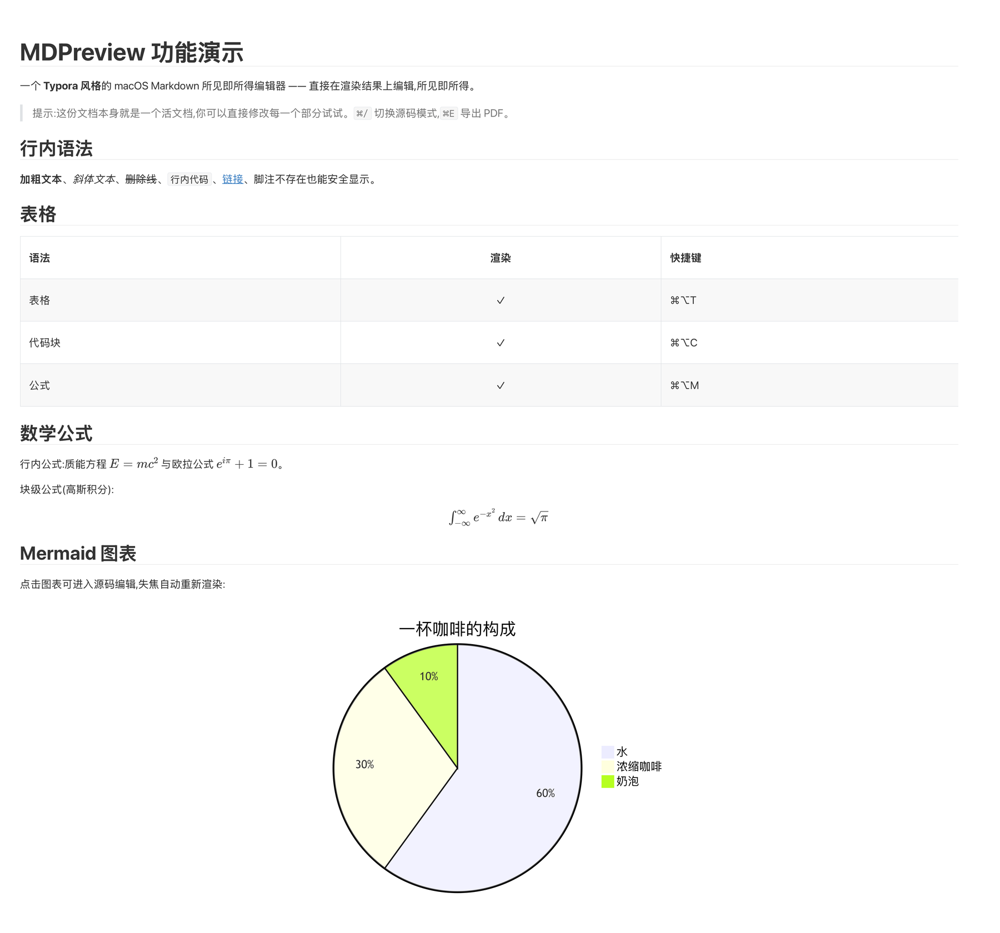
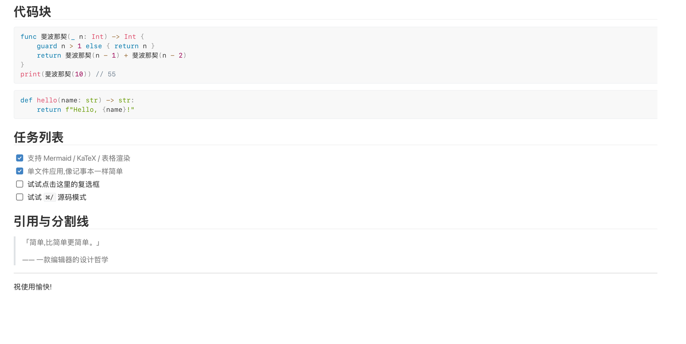
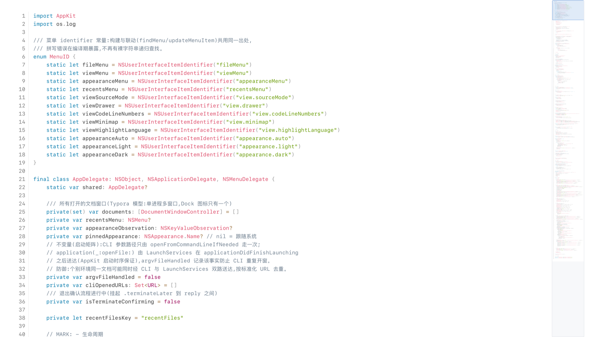

> **README 草稿**：用于评审，确认后再替换根目录 `README.md`。

# MDPreview

**macOS 上的 Typora 风格 Markdown 编辑器。** 打开即写，所见即所得，不需要预览分栏；也可以把代码文件当作只读文档来阅读。

  

<p align="center">
  
</p>
<p align="center"><sub>真实渲染：标题、行内语法、表格、数学公式与 Mermaid</sub></p>

<p align="center">
  
</p>
<p align="center"><sub>真实渲染：代码块、任务列表、引用与分割线</sub></p>

MDPreview 用 Swift/AppKit 做原生外壳，用本地 WKWebView 承载 [Milkdown](https://milkdown.dev)（ProseMirror）编辑器。文件、窗口和菜单交给 macOS，排版和编辑体验交给 Web，启动后不依赖网络。

## 主要功能

- **所见即所得 Markdown**：在排版结果上直接编辑，支持 GFM 表格、任务列表、删除线、引用、代码块、图片、链接与分割线。
- **公式与图表**：KaTeX 行内/块级公式；Mermaid 流程图、时序图、饼图等，点击图表即可修改源码。
- **右侧文档缩略图**：Markdown 和代码的只读预览，滚动时同步视口框；点击或拖动即可定位，长文不必来回滚。
- **只读代码查看**：44 种语言语法高亮、逻辑行行号、软换行、当前行高亮；超过 512 KB 自动降级纯文本。
- **原生文件工作流**：文件抽屉、懒加载目录树、可拖拽宽度、多窗口、最近文件、外部修改监听。
- **查找、导出与外观**：⌘F 查找、源码模式、PDF/HTML/打印；深浅色跟随系统，缩放偏好跨窗口保留。

<p align="center">
  
</p>
<p align="center"><sub>代码只读查看：以项目 Swift 源码为例，行号、软换行与全文缩略图</sub></p>

## 快速开始

要求：macOS 13+、Xcode/Swift 5.9+、Node.js 18+。

```bash
git clone https://github.com/chenlong828/md-previewer.git
cd md-previewer
./build.sh
open dist/MDPreview.app --args /path/to/note.md
```

传入目录会进入抽屉导航模式：

```bash
open dist/MDPreview.app --args /path/to/folder
```

开发构建与自检：

```bash
./build.sh debug
./.build/debug/MDPreview --selftest
```

## 快捷键

| 操作 | 快捷键 |
| --- | --- |
| 新建 / 打开 / 保存 | `⌘N` / `⌘O` / `⌘S` |
| 文档内查找 | `⌘F` |
| 渲染 / 源码模式 | `⌘/` |
| 文件抽屉 | `⌘\` |
| 导出 PDF | `⌘E` |
| 缩放 | `⌘+` / `⌘-` / `⌘0` |
| 打开文件夹 | `⌘⇧O` |

## 架构

```text
Swift/AppKit 壳                         WKWebView（本地资源，无网络）
窗口 · 菜单 · 文件 IO · 偏好 · PDF  ←→  Milkdown / ProseMirror
                                         Markdown · 代码视图 · 缩略图
```

Markdown 解析与排版复用 Milkdown/remark 生态；Swift 与前端通过 v2 桥协议通信。文件读写、脏标记和窗口由原生壳负责，前端只处理编辑、渲染与导出内容生成。

## 文档

- [项目文档索引](doc/README.md)
- [架构设计](doc/design/architecture.md)
- [需求与场景](doc/requirements)
- [已归档工序](doc/history/works)

## 已知边界

- 仅支持 macOS 13+，不是跨平台编辑器。
- 一个窗口一个文档，不提供多标签（有意为之）。
- 代码文件只读，不支持编辑、保存、LSP 或代码折叠。
- 正文最小宽度 860px；窗口更窄时出现横向滚动，不压缩排版。
- 图片按文档复制到 `resource/<文档名>/`，由应用管理引用与清理。

## License

[MIT](LICENSE)
